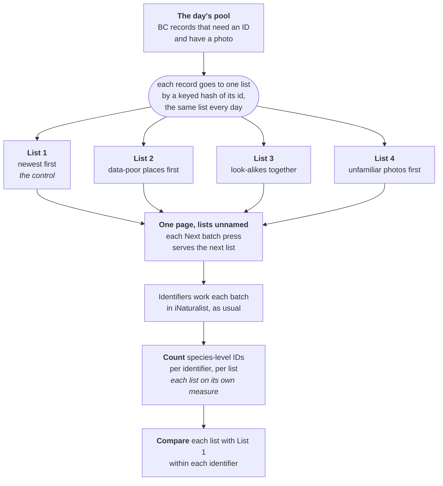

# what-to-id

Does the order of the iNaturalist identification queue change how much gets identified, and what? what-to-id tests this with unlabelled, randomised lists and reads the answer back from iNaturalist. First deployment: British Columbia, with Blitz the Gap. A result from one blitz holds for that blitz's region and identifiers; other regions run the same build to know.

Companion to [where-to-blitz](https://github.com/PollockLab/where-to-blitz), which answers where to go and record.

## Wait, what is this?

- About 2.5 million BC records on iNaturalist wait for an identification. Identifier hours are the limit, not records.
- The queue order decides which records those hours reach. iNaturalist shows newest first. We found no test of whether another order gives more identifications, or more useful ones.
- what-to-id changes only the order. Each record goes to one of four lists by a keyed hash. The page does not name the lists.
- One page serves the lists in turn. Each press of Next batch gives the next list, so each identifier works each list in equal measure. The identifier works in iNaturalist as usual.
- After the blitz, the tool reads each identifier's IDs back and compares each identifier with themself, list against list. Skill cancels out. This is the within-person comparison of interleaved search evaluation ([Chapelle et al. 2012](https://doi.org/10.1145/2094072.2094078)), applied to a citizen-science queue.
- The design is pre-registered. The list assignment is keyed and replayable. The same build runs for any region with a place id and a cell-score layer.
- A second, proposed study turns the same records on their head. Students name photos blind, with no suggestion shown. Their consensus gives the error rate of names the observer accepted from the computer-vision suggestion, and the public record's overturn rate divided by that error gives how much of the error the community catches. Planted expert-named records measure how often the consensus itself is wrong, and that error is removed. The split is general: any crowd-labelled dataset that records whether a label came from a suggestion gives error times detection from its public record, and blind re-labelling of a sample separates the two. See [Blind track](#blind-track-proposed-not-yet-run).

If one order gives more species-level IDs per identifier hour, or fills more data gaps, that order can become the default queue, for BC first and for any region after.

## What the lists test

Every list holds the same kind of records and differs only in order.

| List | Order | Family | Measured on |
|---|---|---|---|
| `recency` | newest first | control | species-level IDs per identifier |
| `similarity` | look-alike photos together (BioCLIP 2.5 embeddings) | speed: fewer context switches | species-level IDs per identifier |
| `gap_first` | data-poor places first (where-to-blitz cell scores, weighted by record age) | value: the Wallacean shortfall ([Hortal et al. 2015](https://doi.org/10.1146/annurev-ecolsys-112414-054400)) and Blitz the Gap's spatial and temporal gaps ([Hébert et al. 2026](https://doi.org/10.32942/X2T09G)) | the same count weighted by how data-poor the place is |
| `novelty` | photos least like any verified photo of their group first | value: the gap in what verified photos cover | new species per grid cell |

`surprise` (opt-in, `--surprise-scores`) orders by how unexpected the proposed species is where, or in what climate, it was seen.

## Experiment diagram



The keyed hash gives every list a like mix of taxon groups and observers, so order is the one thing under test. The lists are unlabelled rather than blind: the page never names them, but a batch of look-alikes shows which list it is.

**Every identifier works every list.** A few identifiers make most of the IDs. If each kept one list, the list that drew the busiest identifier would win whatever its order. So each browser draws one random cycle of the four lists and every Next batch press takes the next list in it:

| | Their cycle | Press 1 | Press 2 | Press 3 | Press 4 | Press 5 | Press 6 | Over the blitz |
|---|---|---|---|---|---|---|---|---|
| Identifier who does 40 batches | 3 → 1 → 4 → 2 | 3 | 1 | 4 | 2 | 3 | 1 | 10 batches from each list |
| Identifier who does 4 batches | 2 → 4 → 1 → 3 | 2 | 4 | 1 | 3 | | | 1 batch from each list |

Each identifier is then compared with themself, their IDs on List 2 against their IDs on List 1, and so on. `python -m what_to_id.power` simulates this against one list per identifier.

## How it works

1. **Pull** the needs-ID records with a photo since a start date (BC, iNaturalist place 7085, set in `inat.py` and `batches.py`). The daily job adds new records and drops served ones that no longer need an ID.
2. **Assign** each record to one list by a keyed hash of its id (`--key-env`). The key is private; every build record carries its fingerprint, which replay checks, so opening the key after the read-back can be verified.
3. **Compose** each list into batches in its order.
4. **Serve** one static page: lists A to D, each a stack of Identify links; the arm behind each letter lives only in the build's `manifest.json`. Each daily build appends what it served to a served log.
5. **Read back** every served record. Identifications keep their timestamps, so the per-identifier comparison is read within a week of the blitz and record outcomes at 30 days.

The BC run is four lists over four weeks; the protocol and pre-fixed outcomes are in [docs/protocol.md](docs/protocol.md). Identification blitzes have precedent ([Mesaglio et al. 2025](https://doi.org/10.1002/ppp3.70005)); the randomised order inside one is new.

## Install

```bash
uv venv && source .venv/bin/activate
uv pip install -e ".[dev]"      # add ,embed for image embeddings, ,similarity for look-alike batches (private labelfirst)
pytest                          # network tests skipped; pytest -m network hits the live API
```

Try it in two minutes: a small sample, two lists, one page.

```bash
python -m what_to_id.inat --d1 2025-01-01 --freeze 2026-11-01 --groups Aves --cap-pages 2 --out data/sample.parquet
what-to-id build --pool data/sample.parquet --freeze 2026-11-01 --d1 2026-11-01 --seed 0 --arms recency,gap_first --design rotation --out out/sample
open out/sample/site/study.html
```

## Use

```bash
# 1. Freeze the needs-ID pool (hours for all groups; --groups and --cap-pages for a sample)
python -m what_to_id.inat --d1 2025-01-01 --freeze YYYY-MM-DD --out data/pool_YYYY-MM-DD.parquet

# 2. Build lists, batches, manifest and site. --max-batches fixes the read-back denominator before the blitz
what-to-id build --pool data/pool_YYYY-MM-DD.parquet --freeze YYYY-MM-DD --d1 YYYY-MM-DD --seed <private-seed> --max-batches N --design rotation --out out/build

# 3. Daily build, as .github/workflows/daily.yml runs it (OFFLINE=1 rehearses on a saved pool)
export WTB_DIR=../where-to-blitz/cluster_results/ca BLITZ_D1=<blitz-start> EMBEDDING_RELEASE=<bundle-tag>
scripts/daily.sh fetch && scripts/daily.sh fetch-embeddings && scripts/daily.sh build

# 4. Rerun any past day from its snapshot; exits 1 unless it serves exactly what the served log says
python -m what_to_id.replay --pool state/days/pool-YYYY-MM-DD.parquet --record state/days/build-YYYY-MM-DD.json --served-log state/served.parquet --webapp-dir "$WTB_DIR" --key-env WHAT_TO_ID_KEY --embedding-bundle data/embedding-bundle

# 5. After the blitz: open the key, read back, list participants, analyse
python -c "import json; from what_to_id.manifest import blind_labels_keyed as b, key_from_env as k; print(json.dumps({v: a for a, v in b(['recency', 'gap_first', 'similarity', 'novelty'], k()).items()}))" > labels.json
python -m what_to_id.readback --pool state/pool.parquet --assign state/served.parquet --label-map labels.json --out out/outcomes.parquet
python -m what_to_id.participants --project ID_OR_SLUG --out participants.txt      # or --logins signups.txt
python -m what_to_id.analysis --idents out/outcomes_idents.parquet --served state/served.parquet --label-map labels.json --control recency --start <blitz-start> --cutoff <read-back-cutoff> --users participants.txt --placebo-start <placebo-start> --obs out/outcomes_obs.parquet
```

The analysis holds each list to its pinned count, one-sided with Holm over `gap_first` and `similarity`, `novelty` exploratory, with a sign test beside each. Embedding preparation, bundle releases, replay guarantees and publishing are in [docs/operations.md](docs/operations.md).

## Blind track (proposed, not yet run)

A second study for a class or a group of new identifiers. Proposed; it runs only after ethics review and the course agrees.

- Most BC records carry a species name the observer accepted from the computer-vision suggestion. On 40,000 BC records, later identifiers overturned 6% of those names and 9% of typed names. The public record cannot tell a correct suggestion from a name people agreed with.
- The blind page shows only the photos and the taxon group. No name, no location, no suggestion. The student types a name and a confidence, or abstains.
- Three to five students see each record. A one-coin Dawid-Skene model ([Dawid and Skene 1979](https://doi.org/10.2307/2346806)) gives each student an accuracy per group and each record a consensus name with a posterior. Planted expert-named records anchor the model and measure the consensus's own error, which is removed.
- Out come the error rate of CV-accepted names without the agreement bias, how much of it the community catches, a test of the Identify levels against human consensus, and a labelled set of hard cases for training.

```bash
python -m what_to_id.blind_planted --obs obs.parquet --idents idents.parquet --pool pool.parquet --out planted.json   # candidates; an expert confirms the names
python -m what_to_id.blind_sample --pool pool.parquet --levels identify.parquet --planted planted.json --per-stratum 4 --out site/records.json
python -m what_to_id.page_blind --records site/records.json --out site/                                             # blind.html
python -m what_to_id.blind_answers --records site/records.json --names names.json --out answers.parquet blind-answers-*.jsonl
python -c "import pandas as pd; from what_to_id.blind_skill import fit; s, c = fit(pd.read_parquet('answers.parquet'), pd.read_parquet('site/planted.parquet')); s.to_csv('skill.csv'); c.to_parquet('consensus.parquet')"
python -m what_to_id.blind_report --consensus consensus.parquet --obs obs.parquet --idents idents.parquet --public pool.parquet --levels site/levels.parquet --answers answers.parquet --planted site/planted.parquet
python -m what_to_id.blind_power          # sample-size table behind the protocol
python -m what_to_id.public_overturn pull --out pull.jsonl && python -m what_to_id.public_overturn tables pull.jsonl   # the public pre-test
```

`blind_report` prints error e of CV-accepted versus typed first IDs against the consensus, detection d (public overturn over e), both corrected for the consensus error c measured on held-out planted records and split by observer experience and by record age, a nowcast d that corrects young read-backs for corrections not yet made (`--delays`, from `public_overturn tables --delays-out`), species-matched ratios, and settled and abstain shares per Identify level. `public_overturn` is the public pre-test that sized this track: overturn by group, observer experience, quarter, within species and per Identify level, plus who corrects, whether the correction was itself a CV suggestion, how long a first ID waits for its first other look, and how many days its correction takes on records a year old. `--hard-cases` writes the training set. `tests/test_blind_recovery.py` and `tests/test_blind_pipeline.py` simulate the model and the whole chain.

## References

- Chapelle O, Joachims T, Radlinski F, Yue Y (2012). Large-scale validation and analysis of interleaved search evaluation. ACM Transactions on Information Systems 30(1):6. [doi:10.1145/2094072.2094078](https://doi.org/10.1145/2094072.2094078).
- Mesaglio T, Shepherd KA, Wege JA, Barrett RL, Sauquet H, Cornwell WK (2025). Expert identification blitz: a rapid high value approach for assessing and improving iNaturalist identification accuracy and data precision and confidence. Plants, People, Planet. [doi:10.1002/ppp3.70005](https://doi.org/10.1002/ppp3.70005).
- Hortal J, de Bello F, Diniz-Filho JAF, Lewinsohn TM, Lobo JM, Ladle RJ (2015). Seven shortfalls that beset large-scale knowledge of biodiversity. Annual Review of Ecology, Evolution, and Systematics 46:523-549. [doi:10.1146/annurev-ecolsys-112414-054400](https://doi.org/10.1146/annurev-ecolsys-112414-054400).
- Dawid AP, Skene AM (1979). Maximum likelihood estimation of observer error-rates using the EM algorithm. Journal of the Royal Statistical Society Series C 28(1):20-28. [doi:10.2307/2346806](https://doi.org/10.2307/2346806).
